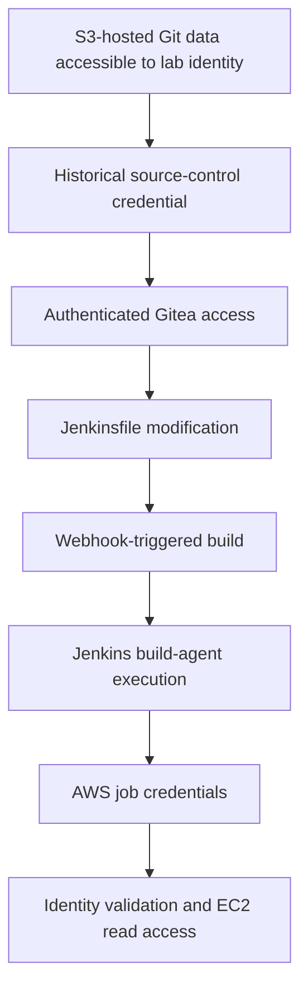

# Attack path and security boundaries

[Portfolio overview](../README.md)

## Git history to build-agent execution

[Case study](../labs/01-git-jenkins-aws.md) · [Sanitized excerpts](../evidence/command-excerpts.md)

## Where controls could interrupt the path

| Boundary | Proposed control |
| --- | --- |
| Published content to private development history | Clean artifact output and restricted S3 access |
| Source-control write permission to privileged build | Reviewed pipeline changes and isolated jobs |
| Jenkins execution to AWS job credentials | Restrict credential delivery and isolate privileged jobs |
| Recovered credential to AWS operations | Scoped identities, temporary credentials, and audit review |

No control in this table is presented as implemented or successfully retested.
